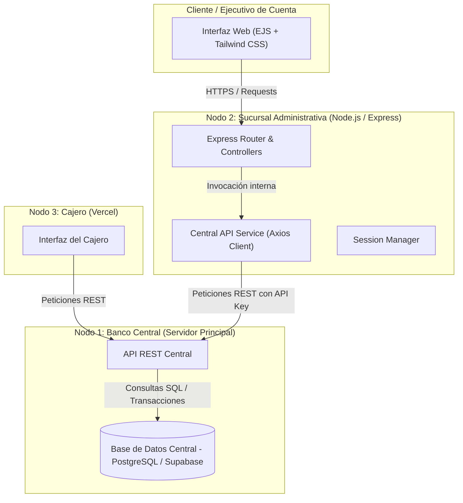

# Sistema Bancario Distribuido: Nodo 2, Sucursal Administrativa

Este repositorio contiene la implementación del **Nodo 2 (Sucursal Administrativa)** dentro de un Sistema Bancario Distribuido. El módulo permite a los ejecutivos de sucursal:

- Gestionar la apertura de cuentas de clientes.
- Consultar estados de cuenta e historial transaccional.
- Consolidar cortes operativos y reportes de auditoría en tiempo real.

Toda la operación se realiza en comunicación sincrónica con el **Nodo 1 (Banco Central)**.

---

## Equipo de desarrollo

- Victor Manuel Mendoza Lara
- Ricardo Rodríguez Arellano
- Emmanuel Reynaldo Gaspar Lara
- Jorge Laurencio Sánchez Rojas

---

## Enlaces de despliegue en producción

| Nodo | Hosting | URL pública | Repositorio |
|---|---|---|---|
| Nodo 1: Banco Central (API) | Render | https://banco-central-panel.onrender.com | [ExamenTWBancoCentral](https://github.com/ReynaldoEGL/ExamenTWBancoCentral) |
| Nodo 2: Sucursal Administrativa | Render | https://sucursal-nodo2-nyl2.onrender.com | [sucursal-nodo2-TOPWEB](https://github.com/Victorml55/sucursal-nodo2-TOPWEB) |
| Nodo 3: Cajero | Vercel | https://cajero-topweb.vercel.app | [Cajero-TOPWEB](https://github.com/ricardo-rodriguezdesk/Cajero-TOPWEB) |

---

## Arquitectura de la red bancaria



---

## Módulos del sistema

### Autenticación y control de sesión (`/login`, `/logout`)
Acceso restringido para ejecutivos de cuenta autorizados en el Nodo 2.

### Apertura de cuentas (`/new-client`, `/create-account`)
- Registro distribuido de clientes.
- Asignación automática de número de cuenta de 10 dígitos mediante el Banco Central.
- Sistema de notificaciones (toasts) en el Dashboard.

### Consulta de cuentas y movimientos (`/search-account`)
Búsqueda en tiempo real de saldos y de la bitácora transaccional (depósitos y retiros) sincronizada.

### Reportes y corte de caja (`/reports`)
- Métricas de liquidez de la sucursal.
- Consolidación de depósito y retiro acumulado.
- Interfaz adaptada para impresión física o PDF.

---

## Estructura del proyecto

```text
sucursal-nodo2/
├── src/
│   ├── config/
│   │   └── supabase.js          # Configuración de base de datos local (opcional/respaldo)
│   ├── controllers/
│   │   └── branchController.js  # Lógica de negocio de la sucursal
│   ├── routes/
│   │   └── branchRoutes.js      # Definición de rutas Express
│   ├── services/
│   │   └── centralService.js    # Cliente de integración Axios con el Nodo 1
│   └── app.js                   # Punto de entrada de la aplicación
├── views/                       # Vistas EJS (interfaz Matte Titanium)
│   ├── login.ejs
│   ├── dashboard.ejs
│   ├── new-client.ejs
│   ├── account-details.ejs
│   └── reports.ejs
├── public/                      # Recursos estáticos (CSS/JS)
├── .env.example                 # Plantilla de variables de entorno
├── openapi.yaml                 # Especificación OpenAPI 3.0
├── package.json
└── README.md
```

---

## Variables de entorno

Para ejecutar el proyecto localmente o desplegarlo en Render o Vercel, configura las siguientes variables en un archivo `.env`:

```env
PORT=3000
SESSION_SECRET=super_secreto_bancario_nodo2
CENTRAL_API_URL=https://banco-central-panel.onrender.com/api
CENTRAL_API_KEY=tu_clave_api_central_aqui
```

> Usa un `SESSION_SECRET` distinto y robusto en producción, y nunca subas tu `.env` al repositorio.

---

## Instalación y ejecución local

1. Clonar el repositorio:

   ```bash
   git clone https://github.com/Victorml55/sucursal-nodo2-TOPWEB.git
   cd sucursal-nodo2-TOPWEB
   ```

2. Instalar dependencias:

   ```bash
   npm install
   ```

3. Iniciar en modo desarrollo:

   ```bash
   npm run dev
   ```

4. Abrir en el navegador: http://localhost:3000
